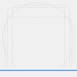

<div align="center">

# Sockety

[](https://github.com/mateusfg7/sockety/actions/workflows/ci.yml)
[](https://github.com/mateusfg7/sockety/actions/workflows/release.yml)
[](./LICENSE)



**A desktop client for testing and debugging Socket.IO servers: connect, emit events and
inspect what comes back.**

Built with [Tauri 2](https://tauri.app), Rust, React and [Kumo](https://github.com/cloudflare/kumo).

<!-- FIXME Uncomment once published at Flathub -->
<!-- <a href="https://flathub.org/apps/details/com.mateusf.Sockety"> -->
<!--  -->
<!-- </a> -->

</div>

> [!NOTE]
> Sockety is in early development. This release ships the app shell only (title bar, theming,
> language switching) — connecting to a server and working with Socket.IO events is coming in a
> future release.

## Building from source

```bash
git clone https://github.com/mateusfg7/sockety.git
cd sockety
pnpm install
pnpm tauri dev      # launches the desktop app with hot reload
```

See [docs/CONTRIBUTING.md](./docs/CONTRIBUTING.md) for build requirements (Node, Rust, platform
packages), the full development command reference and the project layout.

## Contributing

Contributions are welcome! See [docs/CONTRIBUTING.md](./docs/CONTRIBUTING.md) to get set up,
and [docs/RELEASING.md](./docs/RELEASING.md) for how versioning, releases and the Flatpak build
work.

## License

[MIT](./LICENSE) © Mateus Felipe Gonçalves

Made by [Mateus Felipe Gonçalves](https://mateusf.com)
